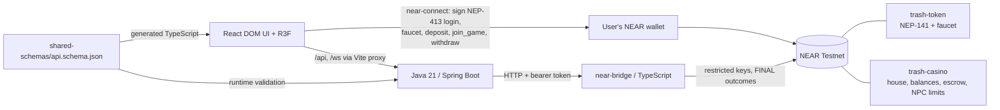

# Architecture

NEAR Testnet only. TRASH has no real-world value. The explicit rules and P0 scope
in [AGENTS.md](../AGENTS.md) take precedence over the older
[specification](SPECIFICATION.md). Gameplay details: [free play](free-play.md).
Economy and its verification: [economy milestone](economy.md).

## Who signs what

| Signer | Key | Transactions |
|---|---|---|
| Player | their own wallet | `token.faucet`, `token.ft_transfer_call` (deposit), `casino.join_game`, `casino.withdraw`, `casino.pay_offer`, `casino.claim_refund` |
| Settler (bridge) | function-call key on the casino | `create_game`, `settle_game`, `cancel_game` |
| NPC (bridge) | function-call key on the casino | `agent_pay` |
| Team (owner) | full-access key, never on a server | deploy, limits, settler change |

The browser holds no keys and decides no outcomes. The LLM (not built yet) will
never receive any key; it can only propose actions that Java validates.

## Paid Liar's Dice flow

1. **Login (NEP-413).** `POST /api/auth/nonce` returns a single-use 32-byte nonce.
   The wallet signs `{message, recipient, nonce}`. `POST /api/auth/verify` asks the
   bridge to check the signature and that the key is a FullAccess key of that
   account. Java then issues a session token. A bare account ID proves nothing.
2. **Money in.** The player claims test TRASH from the token faucet into their
   wallet and deposits it into the casino (`ft_transfer_call`, `{"type":"deposit"}`).
3. **Room.** `ROOM_CREATE {paid: true, sessionToken}`. Every human seat in a paid
   room is bound to a verified account; one wallet, one seat. NPC seats use the
   configured NPC accounts.
4. **Funding (phase `FUNDING`).** On start, Java asks the bridge to
   `create_game`. NPCs are seated with house money by the contract. Each human
   signs `join_game` in their wallet. Java polls `get_game_status` and starts the
   match only when the chain shows every seat paid. If someone leaves or the
   funding window (3 min) passes, Java cancels the on-chain game and every buy-in
   goes back to its casino balance.
5. **Settlement.** At game over Java asks the bridge to `settle_game` with the
   whole pot to the winner. `GAME_RESULT.settlement` and `ROOM_STATE.economy`
   show `PENDING`, then `CONFIRMED` with the transaction hash, or `FAILED`.
6. **Money out.** `withdraw` sends the casino balance back to the wallet.

If the server disappears, any player can call `claim_refund` after the on-chain
deadline (2 hours) and everyone gets their buy-in back.

## Authority and privacy

- The server is authoritative for dice and match results and is **trusted** to
  report them honestly; there is no provably fair randomness. The contract limits
  how money moves: only to seated players, never more than the escrow, once.
- A player view contains only their own dice plus public state.
- Amounts are yoctoTRASH decimal strings in JSON, `BigInteger` in Java, `bigint`
  in TypeScript, `u128` on-chain. No floating point.
- WebSocket messages are validated against the shared schema; unknown fields,
  duplicate keys, and trailing JSON are rejected. Origins are restricted.
- Chain state changes in Java only after a confirmed final execution outcome.

## Runtime

- Java runs without a database by default; rooms, sessions, and nonces are in memory.
- The bridge runs as a separate Node process (or the Compose `chain` profile).
  Without bridge configuration, `/api/chain` reports `enabled: false` and only
  free play is offered. Nothing is simulated.
- Compose runs PostgreSQL and Java; the bridge service starts with `--profile chain`.
