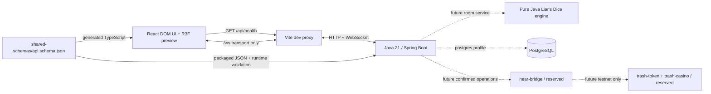

# Architecture — milestone 1

Current free-play implementation supersedes the transport-only status below:
see [free-play multiplayer](free-play.md). The user's updated order puts working
rooms and gameplay before the wallet/chain slice. No monetary boundary has been
replaced by guest authentication.

The repository initially contained only `AGENTS.md` and `docs/SPECIFICATION.md`.
There was no existing code, build, database, or deployment to preserve. The
explicit rules and P0 scope in `AGENTS.md` take precedence over the older, broader
specification. Directory names follow `AGENTS.md`: `web-client`, `backend-java`,
and `shared-schemas`. The repository root itself is the monorepo; no nested copy.

Solid connections are implemented. Dashed connections are reserved or optional.
The engine is tested but deliberately not exposed as an unauthenticated gameplay
API. Transport connectivity does not prove wallet ownership or chain health.

## Responsibilities

| Directory | Current implementation | Next boundary |
|---|---|---|
| `web-client` | React 19, TypeScript, Vite, R3F, drei, Zustand, Tailwind; procedural table/cups/animals; avatar choice; API + WS status | Server-issued views and room controls after wallet signing spike |
| `backend-java/api` | `GET /api/health` | Authenticated REST features |
| `backend-java/websocket` | `/ws`, schema validation, `CONNECTED`, `PING`, `PONG`, `ERROR` | Authenticated identity binding and per-room dispatch |
| `backend-java/games` | Pure Java rules, SecureRandom, private views, reveal, fallback | Room lifecycle, scheduled timeouts, NPC service |
| `shared-schemas` | Draft 2020-12 contracts, generated TS, AJV tests | Versioned schema changes alongside consumers |
| `near-bridge` | Workspace reservation only | Final execution verification, no LLM key access |
| `blockchain` | Contract reservations only | NEP-141 reference + casino limits and sandbox tests |

Other Java packages (`auth`, `players`, `rooms`, `agents`, `negotiations`, `economy`,
`shop`, `blockchain`, `persistence`) will be added as working slices, rather than
empty service abstractions. Treasury and shop are P1, not started.

## Authority and privacy

- The browser holds only the selected preview avatar and connection status. No
  trusted dice, balances, outcomes, wallet claims, or secret material live there.
- The game engine rolls with `SecureRandom`. Bids must increase, fit total dice,
  and come from the current participant. Ones are not wild. The loser starts the
  next round, or the next active seat starts after elimination.
- A player view contains immutable own dice plus public counts and turn/bid
  metadata. A bluff resolution returns an explicit immutable round reveal.
  The future room service must bind `viewFor` and `apply` to verified server-side
  session identities; it must never take an actor ID as proof from the client.
- Human and NPC proposals use the same engine action interface. Its deterministic
  fallback bids `(1,1)` on an empty round and calls bluff otherwise. No LLM call or
  timeout scheduler exists yet.
- The WebSocket accepts only client message types, rejects unknown fields,
  duplicate JSON keys, trailing JSON, and malformed payloads, and limits messages
  to 4096 bytes. Browser origins are restricted. Origin checks are not auth.
- Monetary amounts are base-unit decimal strings in JSON. Future services must
  use `BigInteger`/`bigint`/`u128`, enforce bounds and budgets, and confirm final
  execution before payment or settlement succeeds.
- No blockchain/LLM mocks exist. Any future mock must be labelled `TEMPORARY MOCK`.
  TRASH has no real-world value. All future integration is NEAR Testnet only.

## Runtime

The default Java profile starts without a database, supporting initial rules and
transport work. The `postgres` profile enables JPA and PostgreSQL configuration;
there are no entities, migrations, or persistent gameplay records yet. Compose
runs PostgreSQL and the Java service with that profile. The bridge is omitted
until it has real behavior. Vite runs on the host and proxies `/api` and `/ws`.

The Java Docker build uses the monorepo root as context so it can package the
same schema file as the frontend. No duplicate handwritten TS message types.

## Work remaining

Before more wallet UI, prove wallet connection and NEP-413 signing against current
NEAR documentation. Then implement rooms and connect this engine, add one NPC and
chat with strict proposal validation and 5-second fallback, and sandbox-test the
contracts before testnet deployment. Buy-in, confirmed settlement, one paid info
deal, and a contract-limited tip remain required P0 slices.

The server is trusted to roll dice and report outcomes. There is no commitment
scheme and no trustless or provably fair randomness claim.
